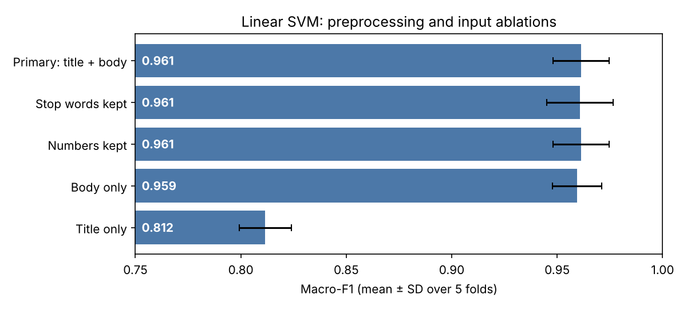

# Arabic News Classification with TF-IDF: Feature Selection, Classifier Transfer and Temporal Evaluation

Master's thesis project, **Master of Computer Engineering, Islamic University of Gaza**
Author: **Rolan Khamis Abu Salem** · Supervisor: **Dr. Mohammed Alhanjouri**

## Overview

How far can the TF-IDF feature space of Arabic news be reduced without losing classification quality on **later** news? The project compares three feature-selection methods under a fixed Linear SVM:

- **Chi-Square** (filter)
- **Information Gain** (filter)
- **Binary Particle Swarm Optimization (BPSO)** (wrapper, 10 independent runs for stability)

The selected representation is then transferred to **SVM, Logistic Regression, KNN and Random Forest**. The final pipeline is evaluated once on a **temporally held-out test set** and compared with a fine-tuned **AraBERTv2-base** reference model.

## Dataset

Arabic news articles collected from the Al Jazeera Arabic website sitemaps (`aljazeera.net`), 20 Mar 2020 to 15 Sep 2026.

| Class | Development (before 26 Aug 2025) | Temporal test (on/after 26 Aug 2025) |
|---|---|---|
| Sport | 544 | 363 |
| Economy | 544 | 363 |
| Health | 544 | 363 |
| Arts | 544 | 363 |
| Family | 544 | 363 |
| **Total** | **2,720** | **1,815** |

Quality controls:

- **Duplicates.** Exact duplicates were found with SHA-256 hashing and near-duplicates with TF-IDF cosine similarity; 5,508 → 5,505 articles.
- **Related-article groups.** Groups were found from title character n-grams (≥ 0.75 similarity, ≤ 30 days apart) and kept inside a single CV fold.
- **Cross-boundary audit.** The highest development–test cosine similarity is **0.62**; no pair reaches 0.80.
- **Label audit.** Two reviewers labeled 250 articles and agreed on 89.2% of them (Cohen's κ = **0.864**). The publisher labels disagreed with the adjudicated human labels in 10% of the audited articles, mostly Family vs Health.

> **Data availability.** Article texts belong to Al Jazeera and are **not** redistributed. `data/article_index.csv` lists every article URL with its date, label, split, group and CV fold, so the dataset can be rebuilt with the collection notebook. See [`data/README.md`](data/README.md).

## Preliminary results (development data, 5-fold group-aware CV)

| Configuration | Macro-F1 (mean ± SD) |
|---|---|
| Majority class | 0.066 |
| TF-IDF + Complement NB | 0.935 ± 0.012 |
| TF-IDF + Logistic Regression | 0.952 ± 0.011 |
| **TF-IDF + Linear SVM** (Stage 1 baseline) | **0.961 ± 0.013** |



Preprocessing variants (keeping stop words or numbers) change Macro-F1 by less than the fold-to-fold variation. Titles alone reach about 0.81, so most of the signal comes from the article body.

## Repository structure

```
├── notebooks/
│   ├── 00_data_collection.ipynb          # sitemap scraping, temporal feasibility, deduplication (Colab)
│   ├── 01_dataset_construction.ipynb     # related groups, label audit, split checks, CV folds
│   └── 02_baselines_and_ablations.ipynb  # baselines, preprocessing/input ablations, leakage check
├── src/
│   └── preprocessing.py                  # Arabic normalization + stop-word removal
├── data/
│   ├── article_index.csv                 # URLs, dates, labels, split, group, fold (no text)
│   └── README.md
├── results/                              # tables and figures
└── requirements.txt
```

## Methodology highlights

- **No leakage by design.** TF-IDF, feature selection and tuning are fitted on training folds only, and the temporal test set is opened once at the end.
- **Fixed folds.** The same `StratifiedGroupKFold` folds (seed 42) are reused in every experiment.
- **Fixed preprocessing.** Unicode normalization, diacritic and Tatweel removal, Alef and Alef Maqsura normalization, NLTK Arabic stop words, and no stemming.
- **Fixed TF-IDF.** Word unigrams with `min_df = 2` and `max_df = 0.95`; the full development vocabulary has 55,885 terms.

## Reproduce

```bash
pip install -r requirements.txt
# place the raw CSV files in data/raw/ (see data/README.md), then run notebooks 01 and 02 in order
```

## Status

- [x] Data collection, cleaning and audits
- [x] Baselines and preliminary analyses
- [ ] Stage 1: Chi-Square / Information Gain / BPSO under a fixed Linear SVM
- [ ] Stage 2: classifier transfer (SVM, LR, KNN, RF) with nested CV
- [ ] Final temporal-test evaluation and AraBERTv2-base comparison

## Tech stack

Python · pandas · NumPy · scikit-learn · NLTK · BeautifulSoup · Requests · Matplotlib · Google Colab
*(planned: PyTorch, Hugging Face Transformers)*
